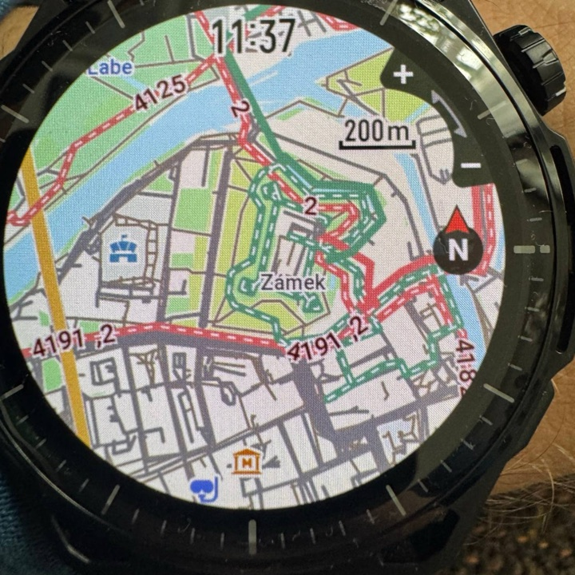
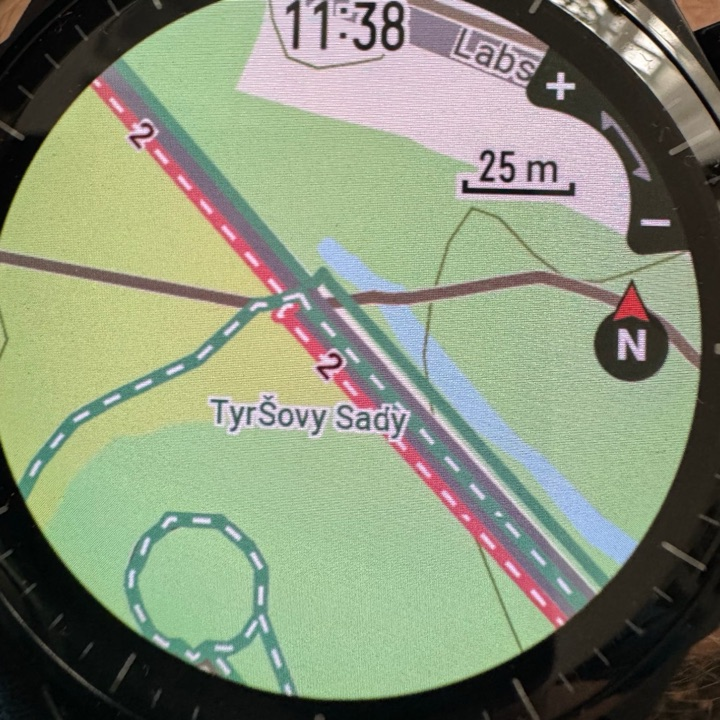
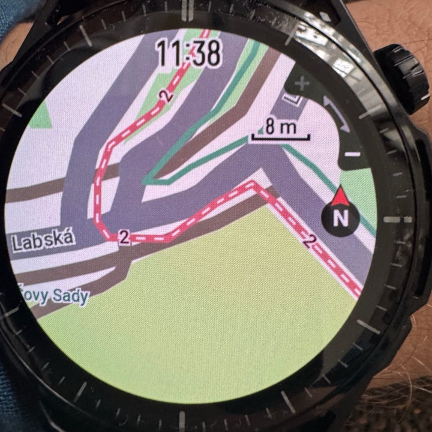

# zeppmap

Turistické značky, cyklotrasy a lanovky v offline mapě hodinek Amazfit se Zepp OS.

> [!WARNING]
> **Neoficiální nástroj, používáte ho na vlastní riziko.** zeppmap nijak nesouvisí se společností Zepp Health ani se značkou Amazfit. Zapisuje do souborů v hodinkách; přepisované soubory si sice zálohuje a každou nahranou dlaždici kontroluje, autor ale neručí za žádné škody na hodinkách, datech ani čemkoli jiném. Software je poskytován tak, jak je, bez jakékoli záruky (viz [licence](LICENSE)).

<p align="center">
  
  
  
</p>
<p align="center"><sub>Amazfit Balance 3 Ti, Pardubice: měřítko 200 m, 25 m a 8 m</sub></p>

## Co to dělá

- **Doplní do mapy hodinek značené trasy:** pěší značky KČT ve svých barvách, naučné stezky, cyklotrasy s čísly, alpské značení s čísly tras a lanovky.
- **Značky jsou vidět při každé aktivitě**, na měřítkách od 8 m do 1,5 km. Vypínají se v hodinkách přepínačem vrstevnic.
- **Oficiální mapa zůstává.** Základní mapa i vrstevnice Zeppu jsou dál vidět; původní dlaždice si nástroj ukládá a umí je kdykoli vrátit.
- **Data jsou z [OpenStreetMap](https://www.openstreetmap.org)**, zdarma a bez registrace. Obnoví se jedním příkazem.
- **Bez telefonu a bez Gadgetbridge:** vše jde z počítače přes Bluetooth a Wi‑Fi hotspot hodinek.

## Jak to funguje

Aplikace Zepp stáhne do hodinek oficiální mapu. zeppmap se k hodinkám připojí, zjistí, kterou oblast mají, a stáhne pro ni z OpenStreetMap značené trasy. Ty nakreslí do mapových dlaždic, složí je s původními vrstevnicemi Zeppu a nahraje zpátky do hodinek. Hodinky je pak kreslí jako součást vrstvy vrstevnic.

Celé to obstará příkaz `sync`. Stačí ho pustit po stažení nové oblasti v aplikaci Zepp nebo jednou za čas kvůli změnám tras.

## Na čem je to vyzkoušené

| | |
|---|---|
| **Hodinky** | Amazfit Balance 3 Ti |
| **Počítač** | MacBook s Apple M4, macOS 26.7 |
| **Software** | Python 3.9, Java (OpenJDK z Homebrew), mkgmap r4924 |
| **Oblast** | celé Česko s okolím (2 048 dlaždic), prohlédnuté v Pardubicích a v Krkonoších |
| **Vyzkoušeno** | značky KČT, polské značení, naučné stezky, cyklotrasy, vrstevnice, zobrazení při běžné aktivitě |

Pravděpodobně to půjde i na dalších hodinkách Amazfit se Zepp OS, které mají offline mapy (například Balance 2 nebo T‑Rex 3), ale nikdo to zatím nezkoušel. Pokud to zkusíte, dejte prosím vědět v [issues](https://github.com/Crempa/zeppmap/issues).

## Co budete potřebovat

- **Hodinky Amazfit s offline mapami**, spárované s aplikací Zepp. V aplikaci si do nich stáhněte mapu oblasti, kde chcete značky, i s vrstevnicemi.
- **Počítač s Bluetooth a Wi‑Fi.** Vyzkoušené je to na Macu a návod níže je pro Mac. Windows a Linux nástroj podporuje, ale se skutečnými hodinkami je zatím nikdo nevyzkoušel (viz [časté otázky](#časté-otázky)).
- **Auth klíč hodinek.** Získá se jednou, návod je níže.
- **Místo na disku:** pro celé Česko asi 1,7 GB (stažené trasy, zálohy vrstevnic a hotové dlaždice), pro menší oblast úměrně méně.

## Zprovoznění krok za krokem

Pokud instalaci necháte na AI asistentovi (Claude Code, Codex a podobně), dejte mu odkaz na tento repozitář. Postup pro asistenty je v [AGENTS.md](AGENTS.md); auth klíč mu ale nedávejte do chatu, uložte ho do souboru sami (krok 3).

Příkazy se zadávají v aplikaci Terminál.

**1. Stáhněte projekt.**

```bash
git clone https://github.com/Crempa/zeppmap.git && cd zeppmap
```

Pokud Mac nezná příkaz `git`, nabídne instalaci vývojářských nástrojů; potvrďte ji a příkaz zopakujte.

**2. Nainstalujte, co nástroj potřebuje.** Python s knihovnami:

```bash
python3 -m venv .venv && .venv/bin/python -m pip install -r requirements.txt
```

Javu (přes [Homebrew](https://brew.sh)):

```bash
brew install openjdk
```

A [mkgmap](https://www.mkgmap.org.uk), který kreslí mapové dlaždice:

```bash
mkdir -p tools && curl -fL -o tools/mkgmap.zip https://www.mkgmap.org.uk/download/mkgmap-r4924.zip && unzip -q tools/mkgmap.zip -d tools && rm tools/mkgmap.zip
```

**3. Získejte auth klíč.** Hodinky přijímají příkazy jen se svým tajným klíčem, který zná aplikace Zepp. Vytáhne ho z vašeho účtu Zepp skript [huami-token](https://codeberg.org/argrento/huami-token); postupujte podle jeho návodu. Ve výpisu najdete u svých hodinek položku *auth key* (32 znaků). Zkopírujte ji a uložte:

```bash
pbpaste > ~/.zeppmap-key && chmod 600 ~/.zeppmap-key
```

Klíč dává přístup k vašim hodinkám, nikomu ho neposílejte. Hodinky v aplikaci Zepp nechte spárované; po odpárování a novém spárování přestane klíč platit a je potřeba ho získat znovu.

**4. Zkontrolujte, že je vše připravené.**

```bash
.venv/bin/python -m zeppmap check
```

Při prvním spuštění se macOS zeptá na povolení Bluetooth pro Terminál; povolte ho.

**5. Vyzkoušejte spojení s hodinkami.** Na telefonu vypněte Bluetooth (hodinky drží jen jedno spojení), probuďte displej hodinek a spusťte:

```bash
.venv/bin/python -m zeppmap services
```

Když vypíše „Authenticated“ a u položek Wi‑Fi hotspot, FTP server a maps „yes“, spojení funguje.

**6. Nahrajte značky.** Nejdřív nanečisto: přečte z hodinek původní vrstevnice, stáhne trasy, sestaví dlaždice a vypíše, co by nahrál, ale do hodinek nic nezapíše. Pro velkou oblast tak už tento krok zabere většinu času prvního běhu (u celého Česka kolem hodiny); následující ostrý `sync` pak už jen nahraje hotové dlaždice.

```bash
caffeinate -i .venv/bin/python -m zeppmap sync --dry-run
```

A pak naostro:

```bash
caffeinate -i .venv/bin/python -m zeppmap sync
```

Během běhu se Mac na chvíli odpojí od domácí Wi‑Fi a připojí se k hotspotu hodinek, pak se vrátí sám. `caffeinate` jen zabrání uspání Macu.

**7. Zapněte značky v hodinkách.** Zavřete a znovu otevřete mapu, v jejím nastavení zapněte vrstevnice a lyžařskou vrstvu nechte vypnutou.

**8. Vraťte hodinky telefonu.** macOS si hodinky po spojení drží. Vypněte Bluetooth na Macu, zapněte ho na telefonu a po připojení hodinek ho na Macu zase zapněte.

## Používání

**Kdy pouštět `sync`:** po stažení nové oblasti v aplikaci Zepp, po aktualizaci map (ta může značky přepsat) a jednou za čas kvůli změnám tras. Nahrává jen dlaždice, které se změnily.

**Jak dlouho to trvá:** první běh pro celé Česko zabral přes hodinu: stažení tras kolem půl hodiny, čtení původních vrstevnic z hodinek 9 minut, sestavení 20 minut a nahrání 396 MB i s kontrolou 14 minut. Další běhy jsou mnohem kratší. Přerušený běh stačí pustit znovu, pokračuje, kde skončil.

**Jak značky vypnout:** přepínačem vrstevnic v nastavení mapy v hodinkách.

**Jak vrátit původní stav:** původní vrstevnice Zeppu jsou ve složce `zepp-contours`. Tuto složku nemažte. Do hodinek je vrátí:

```bash
.venv/bin/python -m zeppmap push zepp-contours --layer ctl
```

## Co se kreslí

| V hodinkách | Co to je |
|---|---|
| plná červená, modrá, zelená | pěší značka KČT této barvy; červená i alpská červeno‑bílo‑červená, s číslem trasy |
| oranžová se žlutým lemem | žlutá značka KČT (čistě žlutou čáru hodinky neumějí) |
| černá se žlutým lemem | černá značka (polské značení) |
| zelená s bílými čárkami | naučná stezka |
| červená s bílými čárkami | cyklotrasa, v popisku číslo trasy |
| tenká okrová s fialovými příčkami | lanovka, v popisku název |

Vede-li po cestě víc značek, jsou vedle sebe. Na měřítkách od 2 km hodinky značky nekreslí, to je dané firmwarem.

Když někde značka chybí nebo vede jinudy, je to v datech OpenStreetMap. Dá se tam opravit a po dalším `sync --refresh` se oprava objeví i v hodinkách.

## Důležité vědět

- **Vlastní riziko.** Nástroj je neoficiální a autor za nic neručí (viz upozornění na začátku). Před každým přepsáním si soubory v hodinkách zálohuje a každou nahranou dlaždici kontroluje.
- **Jedno spojení.** Hodinky se nemohou současně bavit s telefonem a s Macem. Během práce nástroje musí být Bluetooth na telefonu vypnutý.
- **Aktualizace map** v aplikaci Zepp může dlaždice se značkami přepsat. Stačí pak znovu pustit `sync`.
- **Lyžařská vrstva** se značkami nesouvisí. Pokud jste dřív používali `sync --layer ski`, nechte ji vypnutou, jinak se značky nakreslí dvakrát.
- **Veřejné servery.** Trasy se stahují z veřejné služby Overpass. Pro celé Česko je to asi 0,9 GB dat; nepouštějte prosím `sync --refresh` zbytečně často.

## Časté otázky

**Funguje to na Windows nebo Linuxu?** Mělo by, ale na skutečném počítači s Windows nebo Linuxem a s hodinkami to zatím nikdo nevyzkoušel; ověřené je to jen automatickými testy. Vyzkoušené s hodinkami je to jen na Macu. Bluetooth (knihovna bleak), FTP i kreslení dlaždic fungují na všech třech systémech stejně. Liší se jen připojení k Wi‑Fi hotspotu hodinek: na Linuxu ho obstará NetworkManager (`nmcli`), na Windows `netsh` s dočasným profilem sítě, který nástroj po přenosu zase smaže. Pokud se počítač k hotspotu sám nepřipojí, přidejte k příkazu `--manual-wifi` (například `sync --manual-wifi`). Nástroj pak vypíše jméno a heslo sítě hodinek, vy se k ní připojíte sami a on pokračuje, jakmile hodinky uvidí. Instalace se od návodu pro Mac liší: Javu nainstalujte z balíčků svého systému (na Windows například z [adoptium.net](https://adoptium.net)), na Windows se místo `.venv/bin/python` píše `.venv\Scripts\python` a příkaz `caffeinate` jinde než na Macu není. Co chybí, vypíše příkaz `check`. Pokud to zkusíte, dejte prosím vědět v [issues](https://github.com/Crempa/zeppmap/issues), ať už to fungovalo, nebo ne.

**Funguje to na mých hodinkách?** Vyzkoušené je to na Balance 3 Ti. Hodinky musí mít offline mapy a Zepp OS. Spojení ověří příkaz `services` z kroku 5; do hodinek přitom nic nezapisuje.

**Přijdu o oficiální mapu?** Ne. Základní mapa se nemění a vrstevnice zůstávají ve stejné podobě, jen s přidanými značkami. Původní vrstevnice lze kdykoli vrátit (viz [Používání](#používání)).

**Potřebuji účet nebo něco platit?** Ne. Kromě účtu Zepp, který už k hodinkám máte, nic dalšího nepotřebujete.

**Proč nejsou značky vidět při oddálení na 2 km a víc?** Tuto vrstvu hodinky od 2 km nekreslí. Nástroj to obejít neumí.

## Další dokumentace

- [Technické detaily](docs/technicke-detaily.md): jak pracuje `sync`, všechny příkazy a volby, řešení potíží, struktura projektu.
- [Co víme o hodinkách](docs/poznatky-o-hodinkach.md): jak hodinky ukládají a kreslí mapy, výsledky zkoušek se vzorníky.
- [AGENTS.md](AGENTS.md): postup pro AI asistenty (anglicky).

## Licence a poděkování

zeppmap je svobodný software pod licencí [GNU AGPL v3 nebo novější](LICENSE).

- Komunikaci s hodinkami nástroj převzal z projektu [Gadgetbridge](https://codeberg.org/Freeyourgadget/Gadgetbridge) (AGPL v3 nebo novější).
- Mapová data © přispěvatelé [OpenStreetMap](https://www.openstreetmap.org/copyright), licence ODbL.
- Dlaždice kreslí [mkgmap](https://www.mkgmap.org.uk) (GPL), který se stahuje zvlášť.
- Auth klíč získává [huami-token](https://codeberg.org/argrento/huami-token).

Amazfit a Zepp jsou ochranné známky společnosti Zepp Health. Tento projekt s ní nijak nesouvisí.
